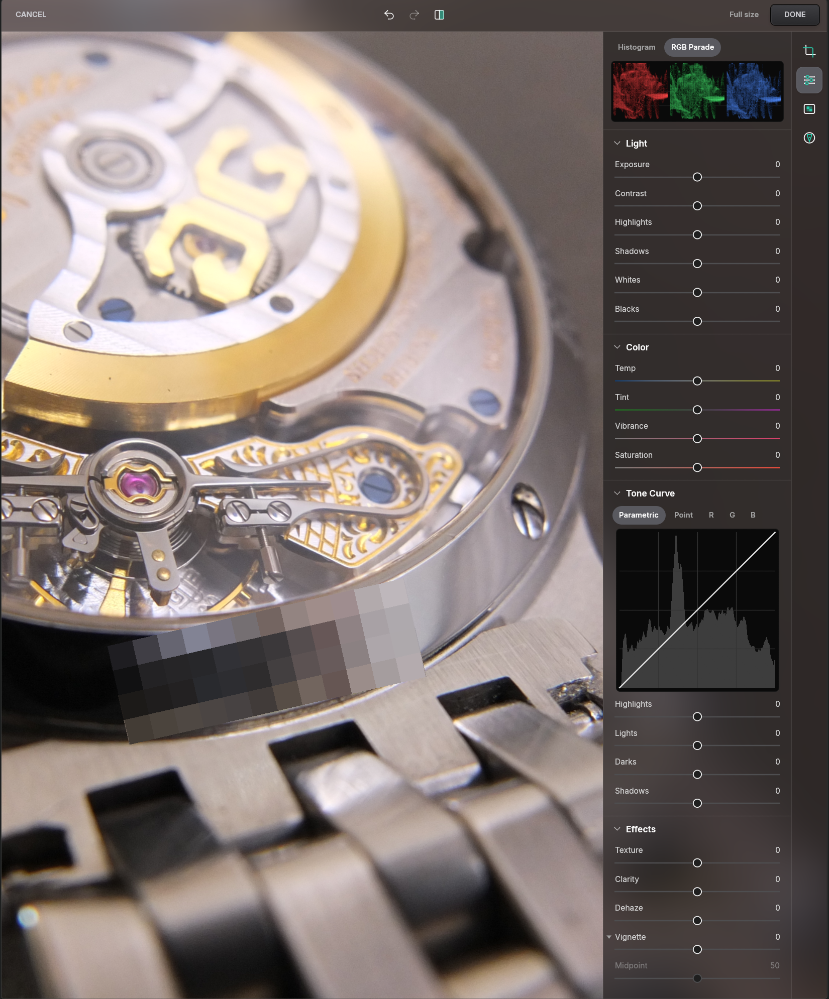

# BEZEL
Browser-Embedded Zoom, Edit & Label

A speedy inline photo editor for Omega Forums. Crop, adjust, hide serials and faces, mark things up. Runs in the browser or an app, built in Rust and WebAssembly.

Demo: [trevc.github.io/bezel-demo](https://trevc.github.io/bezel-demo/)

